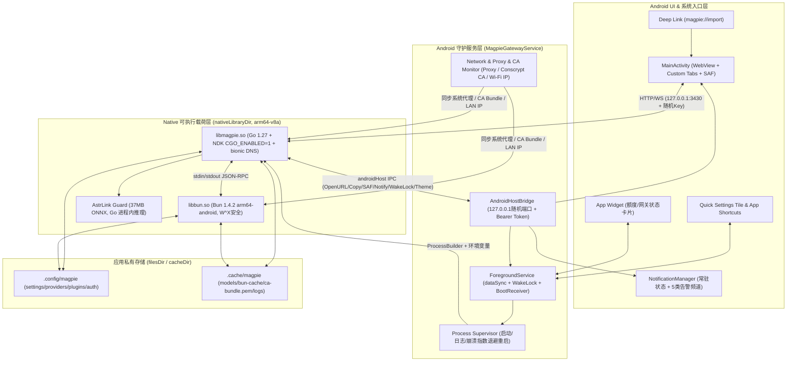
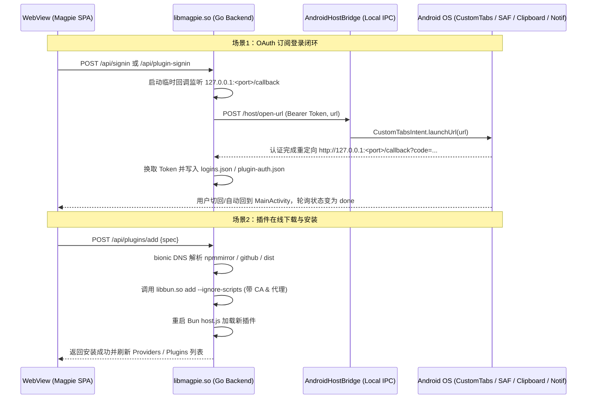
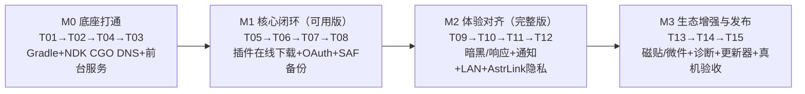

# Magpie for Android 全功能对齐 Windows 端项目实施说明文档

> **假设与范围声明**：本分析经实测拆解附件 `dist/magpie-android-arm64-v0.1.2-offline.apk`（包名 `ai.usemagpie.android`、核心库 `libmagpie.so`/`libbun.so`）并核对工作区工程文件确认，目标产品为 **[yetone/magpie](https://github.com/yetone/magpie)**（AI 编码 Agent 模型/供应商统一管理与本地网关，上游基线 `v0.1.2431`），而非同名 Windows 窗口缩放工具 Blinue/Magpie（需求描述中关于“窗口机制/效果管理/渲染管线”的举例均按 yetone/magpie 的 Windows 桌面壳、插件与网关中间件管线及 WebView UI 渲染对齐映射）；同时因构建机未连接真机执行动态回归，运行时现象基于 APK 二进制/字节码静态取证、工作区真机实测记录（`docs/PLUGIN-PORT.md`）及 Android API 24–34 平台机制推断。

---

## 1. 项目背景与目标

### 1.1 项目背景
- **上游产品定位**：`yetone/magpie` 是一个跨平台 Go 单二进制应用（Windows / macOS / Linux 桌面端采用 Wails v3 + WebView2/WKWebView/WebKitGTK 壳，CLI/TUI/Web 模式使用 `-tags nogui`），核心提供**统一的多模型供应商与订阅账号池、多协议本地 AI 网关（OpenAI Chat/Responses、Anthropic Messages、Gemini、Ollama、MCP）、多策略路由组与故障切换、隐私脱敏、用量与成本观测、OpenCode/Pi/中间件/页面插件生态、资料库与跨设备加密同步**。
- **Android 端现状**：当前仓库 `magpie-android` 已产出非官方移植版 `magpie-android-arm64-v0.1.2-offline.apk`（60.8 MB），采用「Java WebView 极简壳 + Go headless 二进制 `libmagpie.so` + 内置 Bun 运行时 `libbun.so` + 离线预装插件压缩包 `assets/seed.zip`」路线，验证了 APK 可打包、可起服务与展示离线预装插件的最小可行性。
- **核心痛点**：v0.1.2 存在致命底层缺陷——`libmagpie.so` 以 `CGO_ENABLED=0` 编译且无任何原生动态库链接（`DT_NEEDED=[]`），导致 Go 纯 DNS 解析器在无 `/etc/resolv.conf` 的 Android 系统上回落至 `[::1]:53` 并全线报错 `connection refused`。这直接瘫痪了**插件在线发现/下载/更新**、API Key 供应商请求、模型目录同步、OAuth 刷新、云端同步、联网搜索与隐私模型下载等几乎所有 Go 侧联网能力；同时 Android 外壳缺少前台服务保活、Custom Tabs OAuth 闭环、文件导入导出、剪贴板桥接、系统通知、Deep Link、暗色适配与移动端交互优化，距 Windows 桌面端完整体验差距巨大。

### 1.2 项目目标
在**不重写上游 Go 核心引擎**的前提下，通过「**修复 Android Go 底层网络/证书/宿主桥接 + 重构 Android 原生服务与 WebView 宿主壳 + 补齐插件在线/离线下载与移动端专属交互**」，使改造后的 Android 版（目标版本 `v0.2.0` / `v1.0.0`）实现：
1. **能力全对齐**：覆盖 Windows 端 `yetone/magpie` 所有核心与扩展功能（网关、14 个内置插件、88+ 供应商预设、社区插件市场在线下载/更新/本地导入、中间件/页面/面板/工具插件、多策略路由组、隐私脱敏及本地模型、用量/额度/签到/预热、WebDAV/S3/GitHub 同步、加密备份、局域网共享与限额密钥、MCP 与联网搜索/生图工具）。
2. **原生体验达标**：具备前台服务常驻保活、系统通知、Custom Tabs 无障碍 OAuth 登录、SAF 文件导入导出、`magpie://` 导入链接、暗黑模式与 Edge-to-Edge 适配、快捷磁贴/小组件/快捷方式与内置诊断能力。
3. **平台边界清晰**：对受限于 Android 沙箱、W^X 与无桌面 IDE 环境而确实无法 1:1 复刻的 Windows 机制，提供明确的工程级替代方案（如局域网/远程网关、Termux/移动 AI 客户端一键接入、云端同步驱动桌面端），避免死功能或误导性报错。

### 1.3 已锁定架构与发版决策（Locked Decisions）
以下 3 项关键工程决策已由项目方最终拍板，后续实施 Agent **必须严格遵循，不再保留分支选项**：
1. **Go DNS 根治与工程构建体系**：安装 Android NDK（`r26d` 或 `r27c`），使用 `aarch64-linux-android24-clang` 以 **`CGO_ENABLED=1`** 交叉编译 `libmagpie.so` 并动态链接 bionic `libc.so` 彻底解决 Go DNS 解析故障；同步搭配 **JDK 17 / JDK 21** 将手工打包脚本迁移至标准 **Gradle Android 工程**（不再走纯 Go `CGO_ENABLED=0` 过渡路线）。
2. **统一离线预置 APK 形态**：维持**单一统一离线预置包**（同时内置 `libmagpie.so` + `libbun.so` + `assets/seed.zip` 预装精选社区插件），在开箱即用的基础上全面支持在线插件市场浏览、搜索、下载、更新、卸载与本地导入（不拆分 `standard`/`offline` 多渠道变体）。
3. **正式 Release 签名发版**：自下一版本起从 v0.1.2 的 `debug.keystore` 切换为**正式 Release Keystore**（密钥文件与口令通过环境变量 / 未入库 `keystore.properties` 注入，绝不提交仓库），同步更新验收签名指纹基线并在发版说明中提供旧版用户迁移指引（先导出加密 `.magpie-backup` 备份 → 卸载旧版 → 安装正式签名版 → 导入恢复）。

---

## 2. v0.1.2 现状分析结论

### 2.1 APK 静态拆解与工作区取证结果

对 `dist/magpie-android-arm64-v0.1.2-offline.apk` 执行 ZIP 清单、ELF 解析、Go BuildInfo、DEX 字节码字符串提取、签名与对齐校验，并交叉比对 `app/`、`scripts/`、`docs/` 文件，事实清单如下：

| 维度 | 实测值 / 事实证据 |
|---|---|
| **文件与哈希** | `60,838,899 B`（约 58.0 MiB），解压后 `150,084,937 B`，共 14 个条目；SHA-256: `c3254c262832f6bcc03ec9a86e641aee65b272a465d5fa9f3fdea41ff4d99fd8` |
| **应用标识与 SDK** | `package="ai.usemagpie.android"`，`versionCode=3`，`versionName="0.1.2"`，`minSdkVersion=24`（Android 7.0），`targetSdkVersion=34`（Android 14） |
| **签名与对齐** | APK Signature Scheme **v2 + v3 通过**（v1=false），证书为 **Android Debug 调试证书**（RSA 2048，SHA-256 `f923d36c...b18f921`）；`zipalign -c -v 4` 验证通过 |
| **权限与清单配置** | 仅声明 `android.permission.INTERNET`；`usesCleartextTraffic="true"`、`extractNativeLibs="true"`、`allowBackup="false"`；主题 `Theme.DeviceDefault.Light.NoActionBar`；单 Activity `MainActivity` |
| **Java/DEX 外壳** | `classes.dex` 仅 `10,672 B`（对应 `app/src/ai/usemagpie/android/MainActivity.java`，296 行 + 3 个匿名内部类，无任何 AndroidX/第三方依赖，由 `scripts/build-apk3.sh` 手工调用 `aapt2`/`javac`/`d8` 打包） |
| **核心库 `libmagpie.so`** | `63,111,462 B`（压缩后 `25.5 MB`），ELF64 AArch64 PIE（`e_machine=0xb7`, `interp=/system/bin/linker64`），**`DT_NEEDED=[]`（零动态库依赖）**；Go `1.27.0` 编译，`GOOS=android GOARCH=arm64 CGO_ENABLED=0 -tags=nogui`，内嵌版本 `v0.1.2431-android`，与工作区 `out/libmagpie.so` 字节一致 |
| **运行时 `libbun.so`** | `86,800,440 B`（压缩后 `35.1 MB`），ELF64 AArch64 PIE，`bun-linux-aarch64-android` v1.4.2，**`DT_NEEDED=['libc.so', 'libm.so', 'libdl.so']`**（动态链接 bionic），与 `out/libbun.so` 一致 |
| **预置资产 `assets/seed.zip`** | `135,488 B`（stored，10 个条目）：预打包 `.config/magpie/plugins.json`、`plugins/package.json`、`bun.lock` 及两个纯 JS 单文件社区插件 `@magpie-community/opencode-workbuddy-auth@^0.2.9` 与 `@magpie-community/opencode-qoder-auth@^0.2.50` |
| **图标与资源** | 5 档密度 `mipmap-{mdpi..xxxhdpi}/ic_launcher.png` + `resources.arsc`（`app_name=magpie`） |

### 2.2 关键技术纠偏（与历史文档不一致之处）
经直接检索 APK 内 `libmagpie.so` 的二进制段与上游 `main.go` / `internal/gui/web.go` 源码，发现历史文档 `docs/ANDROID-PORT.md` 存在一处误判：
- **误判澄清**：历史文档称「`-tags nogui` 不含内置 gateway 插件（budget/routing/redact 等）」。
- **实测事实**：`main.go` 无条件导入 `_ "github.com/yetone/magpie/plugins/all"`，且 APK 内的 `libmagpie.so` 二进制已完整编入**全部 14 个内置插件**（`budget`、`gateway`、`groups`、`library`、`middleware`、`otel`、`redact`、`rotation`、`routing`、`search`、`sessions`、`tools`、`usage`、`warmups`）、全部 255 个 GUI API 路由、完整多协议网关（`/v1/chat/completions`、`/v1/messages`、`/v1/responses`、`/v1beta/...`、`/mcp/magpie`）以及纯 Go 隐私模型 `astrlink-guard`；且 `magpie web` 内部调用 `gui.StartWeb()` 时会**同进程拉起本地网关（`127.0.0.1:3425`）与 Web UI（`127.0.0.1:3430`）**。`-tags nogui` 真正裁掉的仅是 Wails v3 桌面原生壳（托盘、桌面窗、全局热键、桌面通知等）。

### 2.3 v0.1.2 已实现功能与技术架构盘点
- **已跑通的能力**：
  1. 利用 `extractNativeLibs="true"` 将 `libmagpie.so` 与 `libbun.so` 落地到可执行目录 `nativeLibraryDir`，规避 Android 10+ W^X（应用数据目录 `noexec`）限制。
  2. `MainActivity` 启动 `libmagpie.so web --addr 127.0.0.1:3430 --no-open`，配置 `HOME=filesDir`、`TMPDIR=cacheDir`、`MAGPIE_BUN=nativeLibraryDir/libbun.so`、`MAGPIE_WEB_KEY`，轮询 `127.0.0.1:3430` 就绪后以 WebView 载入 `/?k=<key>`。
  3. 离线预装 WorkBuddy 与 Qoder 插件（解压 `seed.zip` 至 `$HOME`），使二者无需联网下载即可呈现为已安装，且 Bun 运行时可凭借 bionic `libc.so` 正常发起插件侧出网请求。
  4. 基础外壳打磨：应用名称与 5 档图标、返回键优先 `web.goBack()`、浅色状态栏/导航栏去黑边。

### 2.4 v0.1.2 核心缺陷诊断与完成度评估

通过源码与二进制审查，确认 v0.1.2 存在 **8 项阻断级/高危缺陷**：

| 级别 | 缺陷编号 | 根因定位 | 实际影响 |
|---|---|---|---|
| **P0 阻断** | `BUG-01` Go DNS 全线失效 | `libmagpie.so` 以 `CGO_ENABLED=0` 构建（`DT_NEEDED=[]`），Go 纯解析器读取 Android 上不存在的 `/etc/resolv.conf`，回落至 `[::1]:53` 报 `connection refused` | **所有 Go 侧出网请求瘫痪**：插件市场查询（全员显示「即将上线」）、插件在线下载/搜索/更新、88 个预设 API Key 供应商直连、`models.dev` 同步、内置订阅 OAuth/配额刷新、WebDAV/S3/GitHub 同步、联网搜索 API、OTLP、AstrLink Guard 下载、图标代理全部失败 |
| **P0 阻断** | `BUG-02` WebView 宿主能力空心化 | `MainActivity` 仅挂载默认 `new WebViewClient()`，无 `WebChromeClient`、`onCreateWindow`、`onShowFileChooser`、`DownloadListener`，且 Go 侧 `webHost` 的 `OpenURL`/`Copy`/`OpenFolder`/`ChooseFolder` 均为 no-op 或报错 | OAuth 登录外链无法打开系统浏览器/Custom Tabs（Google 拒绝 WebView UA）；备份导入 `<input type="file">` 与导出（写死私有 `$HOME/Downloads`）不可用；剪贴板复制不稳定；无法选本地插件文件 |
| **P0 阻断** | `BUG-03` 无后台保活机制 | 子进程直接由 `MainActivity` 拉起并在 `onDestroy()` 强杀；无 `ForegroundService`、无 `WakeLock`、无崩溃重启 | 退后台、锁屏、横竖屏/内存回收时本地网关与插件宿主直接被杀，局域网共享、长时间流式对话与定时预热/签到无法工作 |
| **P0 阻断** | `BUG-04` 首启解压竞态 | `MainActivity.onCreate()` 先调用 `startServer()` 再异步启动 `seedOfflineOnce()` 线程 | 首次冷启动时 `libmagpie.so` 可能在 `seed.zip` 解压完前读取空目录，导致预装插件不显示或配置损坏 |
| **P1 严重** | `BUG-05` 每次启动覆盖用户配置 | `configureChinaMirror()` 每次 `onCreate()` 无条件覆写 `settings.json` 中的 `chinaMirror=true` 与 `npmRegistry=npmmirror` | 用户在 UI 关闭国内镜像或切换私有 npm 源后，下次重启全部被强行重置 |
| **P1 严重** | `BUG-06` CA 信任库与系统代理断链 | `internal/plugin/systemca_other.go` 仅查 `/etc/ssl/certs/...`（Android 不存在，Android 14+ 在 `/apex/com.android.conscrypt/cacerts`）；`internal/netproxy/system_other.go` 返回空代理 | 企业代理、VPN/抓包 MITM 证书下 Bun 下载插件与请求厂商报 TLS 证书验证失败；无法自动感知 Android Wi-Fi/系统代理 |
| **P1 严重** | `BUG-07` 安全与自更新隐患 | `MAGPIE_WEB_KEY="magpie-android-local-key"` 硬编码在 DEX 中；`StartWeb` 默认启用上游 `updates.start()` 尝试自替换只读的 `nativeLibraryDir/libmagpie.so` | 本机任意第三方 App 可凭已知硬编码密钥接管 `127.0.0.1:3430` 并窃取 API Key；应用内更新按钮报错或无效 |
| **P1 严重** | `BUG-08` 界面与模式适配缺失 | 硬编码白色状态栏/导航栏（暗黑模式严重割裂）；未适配 Android 15 Edge-to-Edge Insets 与软键盘遮挡；无本地 Agent 时 `gatewayMode` 自动隐藏 Agents/Library 入口且无引导；未声明 `magpie://` Deep Link | 夜间模式视觉异常；窄屏下复杂表格/路由图/弹窗易溢出；Provider 一键导入链接不可用 |

**v0.1.2 综合完成度判定：约 28%（架构原型验证完成，核心在线功能与移动宿主未达可用标准）**。
- 可执行二进制封装与离线 Bun 宿主验证：**75%**
- 核心网关与 Go 出网业务可用度：**10%**（受 `BUG-01` 阻断）
- 插件在线下载与全生命周期管理：**15%**（仅离线写死 2 个插件）
- Android 原生宿主与 Windows 壳对齐度：**15%**（缺保活、OAuth 浏览器闭环、文件 SAF、通知、同步、快捷入口）

---

## 3. Windows 端 Magpie 全功能梳理与 Android 差距对照

### 3.1 Windows 端 Magpie 架构与功能全景
Windows 端 `yetone/magpie`（`release-windows`，`-tags production,comlauncher`）包含 **12 大功能域**：
1. **桌面原生壳与系统集成**（Wails v3 + WebView2、托盘菜单与飞鸟动画、Quick Panel 快捷面板、全局快捷键、开机自启、防休眠、Windows Toast 通知、低内存模式、剪贴板/文件管理器/目录选择器、`magpie://` URL Protocol、单实例拉起、`magpie.com` 控制台启动器、应用内自更新、内置 Browser Access 服务）。
2. **多协议本地 AI 网关**（`127.0.0.1:3425` OpenAI Chat/Responses/WebSocket、Anthropic Messages/count_tokens、Gemini v1beta、Ollama、Embeddings/Rerank/Audio TTS & STT/Images/Videos/SystemOne 决策接口、单端口复用 `onePort`、HTTPS TLS、局域网共享、IP 白名单、CORS、远程 Magpie 互联）。
3. **供应商、预设与多账号订阅**（88 预设厂商/聚合站/本地模型、自定义协议、多 Key/多账号权重与独立代理、`models.dev` 元数据补全、自定义模型名/价格/推理档位、`magpie://import` 导入、内置订阅 OAuth/Device Code/Setup-Token 与跨工具账号导入）。
4. **插件生态与扩展管线**（14 个内置插件热开关与 JSON Schema 配置；社区插件市场 `registry.json` + npm 搜索 + GitHub `magpie-plugin` 主题发现 + `@magpie-community` `dist` 分支回退；OpenCode/Pi 供应商插件、5 款官方网关中间件与自定义 JS 中间件、插件路由策略、插件用量观测器、插件 MCP 工具、沙箱 iframe 独立 Page/嵌入 Panel/菜单 Action；Bun 运行时托管与自动更新；本地目录/文件插件安装与冲突裁决 Prefer）。
5. **路由组与容灾引擎**（9 种策略 `smart/order/rotate/usage/pace/weight/free/fast/cheap` + JS 策略、嵌套路由组、按模型/目录条件规则路由、意图路由 Intent Routing、Prompt Cache 会话亲和、429/5xx/排队 `x-magpie-fallback` 故障退避、实时路由拓扑可视化与回放）。
6. **隐私脱敏体系**（规则引擎：Secrets/PII/校验位/自定义词与正则；Mask/Warn/Block 动作与 Never Mask；敏感请求改道发送指定模型；脱敏记录审计与 Try it 预览；本地 AI 模型 **AstrLink Guard** 37MB ONNX 进程内推理与 **Privacy Filter** 1.6GB GGUF `pf-serve` 独立进程推理）。
7. **用量、额度、预算与可观测性**（Token/缓存命中率/解码速度/花费 USD/CNY、额度卡片与 45 天历史、低余额/额度/重置告警、每日预热与每日签到 Check-in、Codex 自动重置、Context 上下文构成剖析、网关 Key 周期预算与短效子 Key 签发、CSV 导出、OTLP 导出）。
8. **联网搜索、媒体生成与 MCP 工具链**（9 种搜索 API 多 Key 轮询与额度查询、代搜与 `web_fetch`、MCP Router 统一代理、内置 Image/Video/Vision/Search/Plugin-Tools MCP 服务）。
9. **资料库（Library）、方案（Profiles）与会话（Sessions）**（全局 Instructions/MCP/Skills/Subagents/Hooks/RTK、Profiles 一键切换、网关会话录制与本地会话检索/导出/迁移）。
10. **加密备份与多端同步**（口令加密 `.magpie-backup` 导出/导入、WebDAV / S3 / GitHub 加密双向同步与定时同步）。
11. **Agent 自动发现与接线**（67+ 桌面 IDE 与 CLI Agent 探测、原子写配置、Drift 漂移修复、WSL 发行版支持、CLI 更新与桌面 App 重启）。
12. **CLI、TUI 与诊断工具链**（完整 CLI 子命令、BubbleTea TUI、系统服务 Daemon、`heap`/`cpu`/`goroutines`/`log`/`healthcheck` 诊断）。

### 3.2 Windows vs Android（v0.1.2）逐项功能差距清单

状态定义：**已实现**（v0.1.2 端到端可用）｜**部分实现**（后端已编入或仅离线/半残，需修复底座或补齐外壳）｜**未实现**（Android 端缺失但可完整实现）｜**平台受限（提供替代方案）**（受 Android 系统机制强约束，无法原样照搬）。

| 域 | 子功能项（Windows 端基线） | v0.1.2 状态 | 现状差距与根因说明 |
|---|---|---|---|
| **1. 外壳与系统集成** | 主窗口展示与内嵌 Web UI | 部分实现 | WebView 可加载本地页，但缺暗色状态栏同步、Edge-to-Edge Insets、字体缩放、键盘适配与渲染崩溃恢复 |
| | 系统托盘图标与 Quick Panel 快捷面板 | **平台受限** | Android 无桌面托盘与悬浮微窗（详见 §3.3-5，改用通知常驻卡片+快捷磁贴+桌面小组件+App Shortcuts） |
| | 全局快捷键（`RegisterHotKey`） | **平台受限** | Android 禁止后台全局截获热键（改用系统 Quick Settings Tile 与桌面微件一键直达） |
| | 后台常驻与进程守护 | 未实现 | 进程绑定 Activity，退后台/销毁即死，缺 `ForegroundService` 与崩溃自拉起 |
| | 登录/开机自启（Autostart） | 未实现 | `autostart_android.go` 仅写 Termux:Boot 脚本，APK 未实现 `BOOT_COMPLETED` 自启 |
| | 保持唤醒（Prevent sleep） | 未实现 | `awake/hold_other.go` 返回不支持；Android 需桥接 `PowerManager.WakeLock` + `WifiLock` |
| | 系统通知（额度/余额/重置/完成/脱敏） | 未实现 | `quota_alert_notify.go` 被 `!nogui` 排除；Android 需通过桥接走 `NotificationChannel` |
| | 外部链接与 OAuth 浏览器打开（`OpenURL`） | 未实现 | `webHost.OpenURL` 为空实现，WebView 无 `onCreateWindow`/Custom Tabs，Google OAuth 拦截 WebView |
| | 剪贴板复制（`Copy`） | 部分实现 | `webHost.Copy` 返回 `false`，明文 `127.0.0.1` 下 `navigator.clipboard` 与 `execCommand` 在部分 WebView 不可靠 |
| | 文件/目录选择与打开（`OpenFolder`/`ChooseFolder`） | 未实现 | `webHost` 直接报错；WebView 无 `onShowFileChooser` / SAF 集成 |
| | `magpie://import` 导入协议拉起 | 未实现 | `AndroidManifest.xml` 未注册 `magpie` scheme 与单实例路由 |
| | 应用内自更新 | 未实现 | 上游二进制自替换无法写入只读 `nativeLibraryDir`，需切换为 APK 独立发布通道更新 |
| | 浏览器访问（Browser Access / 单端口 Web 访问） | 部分实现 | `StartWeb` 本身支持 `--lan` 与单端口复用，但 APK 写死绑定 `127.0.0.1:3430` 且无局域网管理入口 |
| **2. 本地网关与网络** | 多协议推理网关（OpenAI/Anthropic/Gemini/Ollama/媒体/Embedding/Rerank） | 部分实现 | 代码全部编入 `libmagpie.so` 且随 `StartWeb` 监听 `3425`，但受 Go DNS 失效阻断无法连上游厂商 |
| | 局域网共享、IP 白名单、CORS、HTTPS TLS | 部分实现 | 后端逻辑完整，但缺 Android 局域网 IP 展示、TLS 证书 SAF 导入、后台常驻支撑 |
| | 远程 Magpie 互联（作为客户端或服务端） | 部分实现 | 受 Go DNS 失效与后台易被杀影响不可用 |
| | 系统代理感知与自定义 CA 信任 | 未实现 | Android Wi-Fi/VPN 代理未注入 Go/Bun；Android 14+ Conscrypt CA 与用户 CA 未导出给 Bun |
| **3. 供应商与订阅** | 88+ 预设供应商 & 自定义 OpenAI/Anthropic/Bedrock/Vertex | 部分实现 | UI 与后端完整，但 Go DNS 故障导致所有直连 API Key 探测、拉模型与对话全部失败 |
| | `models.dev` 目录同步与自定义别名/价格/档位 | 部分实现 | 逻辑完整，受 Go DNS 阻断无法同步 |
| | 内置订阅登录（Codex/Copilot/Gemini/Antigravity 等） | 部分实现 | 需修复 Go DNS + Custom Tabs OAuth 回调闭环；支持回调 URL/设备码粘贴 |
| | 内置 Claude 订阅本地桥接（驱动 `claude` CLI） | **平台受限** | Anthropic 无 Android `claude` 原生包且受 W^X 限制（详见 §3.3-3，改用 API Key / Setup-Token / Remote Magpie） |
| | 跨桌面工具自动发现凭证与系统钥匙串读取 | **平台受限** | Android 沙箱禁止跨应用读取且无桌面 Agent 目录（详见 §3.3-4，改用文件/同步导入与直接登录） |
| **4. 插件生态与下载** | 14 个内置插件热开关与参数 Schema 表单 | 已实现* | 已编入二进制并可渲染配置；涉及联网的插件待 DNS 修复后完整生效 |
| | 插件市场列表（`registry.json`）与 npm 版本查询 | 未实现（故障） | 受 `BUG-01` Go DNS 失效影响，所有未预装插件均显示「即将上线」不可点击 |
| | **插件在线下载、安装、搜索与一键更新** | 未实现（故障） | Go DNS 阻断 npm/GitHub/dist 元数据查询；且 Android 无系统 `git` 导致部分 `github:` 源失败；用户明确核心需求 |
| | 本地插件安装（文件/目录/压缩包导入） | 未实现 | WebView 无 SAF 文件选择，无法将用户下载的 `.js`/`.tgz`/`.zip` 导入 `$HOME` 并执行 `plugin add` |
| | 预装社区插件（WorkBuddy / Qoder）运行 | 部分实现 | 存在首启解压竞态（`BUG-04`）与设置覆写（`BUG-05`），且 OAuth 登录缺 Custom Tabs |
| | Bun 运行时托管与安全生命周期 | 部分实现 | `libbun.so` 已内置并设 `MAGPIE_BUN`，但缺 W^X 更新保护与版本诊断提示 |
| | 网关 JS 中间件（5 款官方 + 自定义脚本） | 部分实现 | 引擎已编入 `libmagpie.so` + `libbun.so`，修通下载与本地导入即可完整运行 |
| | 插件扩展点（路由策略、用量观测器、MCP 工具、沙箱 Page/Panel/Action） | 部分实现 | Go 与前端内核均已内置，需实测 WebView 对 `sandbox="allow-scripts"` iframe 与 `postMessage` 桥接兼容性并修复下载 |
| **5. 路由组与调度** | 9 种路由策略、嵌套组、规则路由、意图路由、会话亲和、实时拓扑 | 部分实现 | 全量编入二进制，受 Go DNS 阻断且窄屏移动端路由画布交互待优化 |
| **6. 隐私脱敏** | 规则脱敏（Secrets/PII/自定义词/动作/改道/观测/试一试） | 已实现* | 纯本地规则与观测 UI 已在 `libmagpie.so` 中，网关打通即可端到端生效 |
| | 本地 AI 脱敏模型：AstrLink Guard（37MB ONNX 纯 Go） | 部分实现 | 代码已编入且 `Supported()=true`，仅被 Go DNS 阻断无法从 HuggingFace/`hf-mirror` 下载 |
| | 本地 AI 脱敏模型：Privacy Filter（1.6GB GGUF `pf-serve`） | 未实现 | 上游 `serveSHA` 无 `android-arm64` 构建且无法在 `cacheDir` 执行；需 NDK 编译进 `nativeLibraryDir` 或作为可选增强模块 |
| **7. 用量、额度与可观测** | Token/费用统计、额度卡片、历史趋势、Context 剖析、Budget 限额与子 Key | 部分实现 | 核心逻辑完整，需修复 Go DNS（拉额度/汇率）、前台保活（每日预热/签到循环）、SAF（CSV 导出）与通知（告警） |
| | OTLP 遥测导出 | 部分实现 | 已编入 `plugins/otel`，受 Go DNS 阻断 |
| **8. 搜索与 MCP 工具** | 9 种搜索 API、代搜、`web_fetch`、Image/Video/Vision/Plugin-Tools MCP | 部分实现 | 已编入，受 Go DNS 阻断；远端 SSE/HTTP MCP 可完整支持，本地 stdio 非 Bun 命令受限（见 §3.3-6） |
| **9. 资料库、方案与会话** | Library（Instructions/MCP/Skills/Subagents/Hooks）、Profiles、网关录制会话 | 部分实现 | 后端存储与 Web UI 完整，但 `gatewayMode` 默认隐藏 Library，且无本地桌面 Agent 可直接写入（以云同步和网关录制会话为主） |
| | 桌面终端一键恢复会话（Open in Terminal） | **平台受限** | Android 无桌面终端恢复机制（详见 §3.3-5，提供会话只读浏览、Markdown/JSON 导出与文本复制） |
| **10. 备份与同步** | 加密 `.magpie-backup` 导出与导入 | 未实现（故障） | 导出落盘私有目录不可见，导入因缺 `onShowFileChooser` 无法选文件 |
| | WebDAV / S3 / GitHub 加密双向同步 | 部分实现 | 后端已编入，受 Go DNS 阻断与缺后台定时保活影响 |
| **11. Agent 接线与 WSL** | 自动探测并改写 67+ 桌面 Agent 配置、CLI 更新、桌面进程重启、WSL 孪生 | **平台受限** | Android 沙箱隔离且无桌面 IDE/CLI/WSL（详见 §3.3-1、§3.3-2，改用局域网/本地 AI App 接入与 Termux 桥接） |
| **12. CLI、TUI 与诊断** | 终端 CLI、TUI、日志与性能剖析（`log`/`heap`/`cpu`/`goroutines`） | 未实现 | APK 无内置控制台，仅支持 adb 调命令行；需在 App 内提供诊断与轻量命令执行面板及一键日志导出 |

> 注：表中带 `*` 项表示本地逻辑已在 `libmagpie.so` 闭环，但依赖网关上下游联网才能产生完整业务价值。

### 3.3 Android 平台不可直接实现项专项说明与替代方案

以下 6 类 Windows 端能力因与桌面操作系统机制强耦合，**在非 Root 的标准 Android 沙箱环境下无法 1:1 原样实现**，项目将按如下替代方案闭环：

| 序号 | Windows 端能力 | Android 无法直接实现的原因 | 推荐替代方案（纳入本次实施） |
|---|---|---|---|
| **L1** | 直接探测与改写本机 67+ 桌面编码 Agent 配置文件、升级 CLI 及重启桌面进程 | Android 上不存在这些桌面 IDE/CLI；应用沙箱严格禁止跨应用读写其他 App 私有目录或重启其他进程 | ① **局域网/远程网关中心模式**：手机开启局域网共享或通过「远程 magpie」为 PC/Mac/服务器上的桌面 Agent 统一提供供应商、账号池与路由；② **移动 AI 客户端一键接入**：提供 OpenAI / Anthropic / Gemini 标准端点与密钥的**一键复制 / 二维码 / 常见移动客户端（Cherry Studio、RikkaHub、ChatBox、Kelivo 等）及 Termux 环境变量导出脚本**；③ 保留手动关闭 `gatewayMode` 查看所有 Agent 能力与资料库的入口 |
| **L2** | Windows WSL 发行版探测、WSL Agent 接线与 WSL 会话聚合 | Android 内核与系统框架不存在 WSL 子系统 | 不渲染 WSL 开关；在需要终端编码的场景提供 **Termux 一键接入指南/环境变量片段**（Termux 与本 App 共享 `127.0.0.1:3425` 回环网络），并可通过「远程 magpie」查看桌面端汇总用量 |
| **L3** | Claude 订阅本地桥接（驱动本机 `claude` 二进制 + ConPTY 交互模式）及依赖厂商原生 CLI 的登录（如 Grok Build CLI） | Anthropic 未发布 Android ARM64 原生 `claude` 二进制；Android 10+ W^X 禁止运行时下载外部 ELF 到数据目录并 `exec` | ① UI 显式标注平台差异并引导使用 **Claude API Key**、**Setup-Token**（或通过 **Remote Magpie** 连接桌面/服务器上的 Claude 订阅桥接）；② Grok 等插件支持在桌面端登录后通过加密同步/凭证导入或选择纯 HTTP 协议的社区插件 |
| **L4** | 跨桌面应用凭证自动发现与系统钥匙串（Windows Credential Manager）读取 | Android 应用沙箱禁止读取其他 App 登录态，且无对应桌面 Agent 凭证目录 | 强化 **App 内 OAuth/Device-Code（Custom Tabs）登录**、**回调地址/设备码/Token 手动粘贴**，以及通过 **`.magpie-backup` / 标准账号 JSON / WebDAV / S3 / GitHub 同步**无缝迁移桌面端已登录配置 |
| **L5** | Windows 托盘飞鸟图标动画、悬浮 Quick Panel、全局热键（`RegisterHotKey`）、多显示器窗口位置记忆、`magpie.com` 启动器、桌面终端打开会话 | Android 为全屏触控活动栈模型，无系统托盘、无后台全局热键、无自由浮动桌面多窗与桌面终端模拟器 | 映射为 Android 原生入口矩阵：① **前台服务常驻通知**（展示网关状态、活跃请求与一键开关）；② **Quick Settings Tile**（下拉控制中心磁贴）；③ **桌面 App Widget**（直览关键订阅额度/余额）；④ **App Shortcuts**（长按图标直达 Providers/Plugins/Usage/Gateway）；⑤ 会话页提供阅读、检索与 Markdown 导出分享 |
| **L6** | 本地 stdio MCP 子进程运行任意桌面命令行（`npx`/`uvx`/`python` 等） | Android 缺少全局 Node/Python/Shell 工具链，且 W^X 禁止动态释放二进制执行 | ① 完整支持所有 **Remote SSE / Streamable HTTP MCP 服务器**；② 完整支持 Magpie 内置 MCP 服务（`/mcp/magpie/search`、`/mcp/magpie/image`、`/mcp/magpie/vision`、`/mcp/magpie/tools`）及基于内置 **`libbun.so`** 的插件工具运行时；③ Library 中的桌面 stdio MCP 配置照常保存并随同步下发到桌面端 |

---

## 4. 优化完善方案与完整功能需求列表

### 4.1 关键优化方向总览
针对第 2、3 节识别的差距，本方案从五个层面系统推进：
1. **底层网络与运行时根治（解除一切联网封锁）**：采用 Android NDK（`r26d`/`r27c`）交叉编译 `CGO_ENABLED=1` 链接 bionic `libc.so`（彻底解决 Go DNS 解析），并配套 Android 14+ Conscrypt 系统与用户 CA 聚合导出、Android Wi-Fi/VPN 代理自动同步。
2. **插件下载与扩展管线全面对齐（核心重点）**：全面打通社区市场、npm 搜索、GitHub `magpie-plugin` 发现、国内镜像切换、自定义 Registry、一键下载/安装/更新/卸载、无 `git` 环境下的 GitHub Tarball 下载、SAF 本地插件文件/压缩包导入、Bun W^X 安全护栏、插件自定义 Page/Panel/Middleware/Tools/Strategy 端到端运行，彻底消除首启竞态与配置覆写缺陷。
3. **网关可靠性、安全与后台常驻**：以 `MagpieGatewayService`（ForegroundService）解耦进程与 Activity 生命周期，补齐随机 `MAGPIE_WEB_KEY`、崩溃自恢复、`WakeLock` 防休眠、开机自启、局域网共享与二维码接入、内存压力治理。
4. **WebView 渲染、原生桥接与移动交互体验**：构建 `AndroidHostBridge` 填补 `gui.Windows` 全部能力（Custom Tabs OAuth、SAF 备份导入导出、剪贴板、系统通知、`magpie://` Deep Link、暗黑模式系统栏联动、Edge-to-Edge Insets、字体缩放、软键盘避让、窄屏响应式 CSS 补丁、快捷磁贴/小组件/快捷方式）。
5. **高级功能闭环与运维工程化**：启用纯 Go 本地隐私模型 **AstrLink Guard**（并明确 Privacy Filter 扩展边界）、内置轻量诊断与日志导出面板、切换 APK 独立升级通道、将手工 bash 脚本升级为标准 Gradle + NDK 可复现工程。

### 4.2 完整功能需求列表（含验收标准）

#### A. 网络底座与安全基线（P0）

| 需求 ID | 需求名称 | 详细描述 | 验收标准（AC） |
|---|---|---|---|
| **FR-01** | Android 原生 DNS 解析修复（已锁定 NDK CGO） | Go 后端 `libmagpie.so` 强制使用 Android NDK（`r26d`/`r27c`）以 `CGO_ENABLED=1` 链接 bionic `libc.so`（不设 `netgo`），并开启 16KB ELF 页对齐，原生走 Android `netd` 支持 Wi-Fi、4G/5G、IPv6、VPN、Private DNS(DoT) 切换无中断 | ① `readelf -d libmagpie.so` 明确列出 `NEEDED: [libc.so]` 且 `PT_LOAD` 对齐 `0x4000`；② 真机 Wi-Fi/移动网络/VPN 切换下，`GET /api/plugins/npm`、`POST /api/sync`、API Key 测试请求全部 200 成功，logcat 零出现 `[::1]:53: connection refused` |
| **FR-02** | Android CA 证书链与系统代理同步 | 收集 Android 系统 CA（`/apex/com.android.conscrypt/cacerts`、`/system/etc/security/cacerts`）及用户 CA 合并为 PEM 文件，自动通过 `SSL_CERT_FILE` / `NODE_EXTRA_CA_CERTS` 注入 Go 与 Bun；监听 `ConnectivityManager` 代理变化同步至 Go `netproxy` | ① Go 与 Bun 访问标准 HTTPS 端点 100% 验证通过；② 手机配置 Wi-Fi HTTP 代理并信任抓包用户 CA 后，Go 供应商请求与 `bun add` 均自动经代理成功且无 `UNABLE_TO_VERIFY_LEAF_SIGNATURE` 报错 |
| **FR-03** | 本地服务鉴权安全加固 | 移除硬编码 `magpie-android-local-key`，首次启动使用 `SecureRandom` 生成 32 位十六进制密钥持久化至应用私有目录（权限 `0600`），作为 `MAGPIE_WEB_KEY` 注入；同时生成一次性 Bridge Token 保护 Go↔Android 本地回调通道 | ① `classes.dex` 反编译字符串中不含固定登录密钥；② 重启 App 后密钥保持一致（WebView Cookie 有效）；③ 未携带正确 Token 的本地 HTTP 请求访问桥接接口返回 `401/403` |

#### B. 插件发现、下载、安装与全扩展运行（P0 — 核心方向）

| 需求 ID | 需求名称 | 详细描述 | 验收标准（AC） |
|---|---|---|---|
| **FR-04** | 插件市场在线加载与版本查询 | 修复 Plugins → Discover 页面：在线拉取 `registry.json`（国内镜像走 jsDelivr）、并行查询 npm 最新版本号与周下载量、展示 GitHub `magpie-plugin` 主题仓库列表与 README 详情 | ① 打开 Plugins 页 8s 内加载全部社区插件真实版本号，已发布插件按钮显示「安装 / Install」而非「即将上线」；② 搜索 `opencode` / `pi` / 关键字可返回 npm 搜索结果；③ 点击卡片可渲染完整 README |
| **FR-05** | 社区插件在线下载、安装、更新与卸载 | 支持在 Plugins 页一键下载/安装任意社区 Provider 插件（如 Cursor、Kiro、Zed、Factory、ZCode、OpenCode Zen Free 等）、5 款网关中间件、Page/Panel/Tools 插件；支持单个更新、全部检查更新、启停切换、卸载、版本冲突 Prefer 选择 | ① 实测在线点击安装至少 1 个未预装 Provider 插件（如 `@magpie-community/opencode-zen-free-auth`）与 1 个中间件插件（如 `@magpie-community/middleware-model-map`），均返回成功且宿主热重载；② 点击「检查更新」「关闭」「卸载」状态实时生效且重启不回退 |
| **FR-06** | 无 `git` 环境下的 GitHub 插件安装支持 | 针对 Android 无系统 `git` 二进制的问题，在 Go/Bun 安装链路中对 `github:owner/repo[#ref]` 及 GitHub URL 增加纯 HTTPS Tarball（`codeload.github.com` / 镜像回退）下载与解包注册能力 | ① 在无 `git` 命令的真机上输入 `github:<owner>/<repo>` 插件规格，可完成下载、校验入口并加载运行，不报 `git: executable file not found` |
| **FR-07** | 本地插件文件/压缩包导入安装 | 补齐移动端本地安装入口：通过 Android SAF 选择 `.js`/`.mjs`/`.ts`/`.tgz`/`.zip` 插件文件或插件目录，复制到 `$HOME/.config/magpie/local-plugins/<name>` 后自动调用 `POST /api/plugins/add` 注册并加载 | ① 点击「从本地安装」拉起系统文件选择器；② 选中自定义 `.middleware.js` 或 `.tgz` 后自动导入并在 Installed 列表出现、状态为已加载，重启 App 后路径仍有效 |
| **FR-08** | 镜像源与首启离线预装机制修复 | ① `seedOfflineOnce()` 改为在启动 `libmagpie.so` 前同步执行（带进度提示），消除冷启动竞态；② `configureChinaMirror()` 仅在首次无 `settings.json` 时根据系统语言/地区（`zh-CN`）初始化默认值，绝不再覆盖用户后续修改；③ 支持用户在 UI 自由切换「国内镜像」与自定义 `npmRegistry` | ① 全新安装首次启动直接可见预装插件且无 JSON 损坏日志；② 用户手动关闭「国内镜像」或修改 npm Registry 后强杀重启 App，设置完整保留 |
| **FR-09** | Bun 运行时 W^X 安全托管 | `MAGPIE_BUN` 强制锁定 `nativeLibraryDir/libbun.so`；屏蔽 `bunupdate.go` 往 `cacheDir` 下载新 Bun 后执行的操作，防止 Android 10+ 触发 `EACCES`；在插件页清晰展示内置 Bun 版本 | ① 触发插件操作与后台定时任务时，不会向 `cacheDir/bun/` 下载可执行文件或报错 `EACCES`；② `/api/plugins` 返回 `bun=true` 与准确 `bunVersion` |
| **FR-10** | 插件全扩展点与参数配置 | 完整验证并保障社区插件的 6 类能力在 Android 运行：Provider 登录与推理、Middleware（JSON Options 表单编辑）、JS 路由策略、Usage 观测器、Plugin MCP Tools、沙箱 iframe Page/Panel（含 `magpie.service` 反向代理与 `postMessage` 通信） | ① 安装并配置 `middleware-model-map` 后经网关发请求验证模型重定向生效；② 安装任意 `page` 类插件（如 `@magpie-community/page-chat`）在 WebView 中正常加载、读取授权数据且不触发 CSP 拦截 |

#### C. 后台常驻、生命周期与网关共享（P0）

| 需求 ID | 需求名称 | 详细描述 | 验收标准（AC） |
|---|---|---|---|
| **FR-11** | 前台服务守护进程 (`MagpieGatewayService`) | 将 `libmagpie.so` 进程生命周期迁移至独立 `Service`（`foregroundServiceType="dataSync"`），展示常驻通知（含网关地址、运行状态、重启/停止按钮）；Activity 销毁不杀服务；进程异常退出按指数退避（1s/3s/10s）自动重启并记录崩溃原因 | ① 退后台与锁屏 30 分钟后，本地回环及局域网请求 `GET /v1/models` 仍 200 响应；② 手动滑掉最近任务卡片后网关继续运行，从通知栏点「停止」可干净关闭进程并释放端口 |
| **FR-12** | 保持唤醒与开机自启 | ① 桥接「Prevent sleep / 保持唤醒」至 Android `PARTIAL_WAKE_LOCK` + `WIFI_MODE_FULL_HIGH_PERF` 锁；② 新增 Android `BOOT_COMPLETED` 广播接收器，与 Settings → General → 「开机自启」开关打通，并附带电池优化白名单引导 | ① 开启「保持唤醒」后锁屏状态下持续流式对话与定时任务不断流；② 开启「开机自启」后重启设备，前台服务自动拉起并开始监听 `3425`/`3430` |
| **FR-13** | 局域网共享、浏览器访问与移动客户端一键接入 | 支持在 Settings → Network 开关局域网共享与 Browser Access（绑定 `0.0.0.0`），正确探测并展示本机 Wi-Fi IPv4 地址；提供局域网共享 Key 限额管理、TLS 证书 SAF 导入；新增移动端客户端（OpenAI/Anthropic/Gemini/Termux）一键复制与二维码卡片 | ① 开启局域网共享并创建网关 Key 后，同一 Wi-Fi 下 PC 执行 `curl http://<手机IP>:3425/v1/models -H "Authorization: Bearer <key>"` 返回模型列表；② 手机内 Termux 通过 `127.0.0.1:3425` 正常调用网关 |

#### D. WebView 原生桥接、登录闭环与移动端交互（P0–P1）

| 需求 ID | 需求名称 | 详细描述 | 验收标准（AC） |
|---|---|---|---|
| **FR-14** | 外部浏览器 / Custom Tabs OAuth 登录闭环 | 拦截 `OpenURL`（`/api/open`）及 WebView `window.open` / 外部域名跳转，拉起 **Android Custom Tabs**（回退系统浏览器）完成 OAuth / Device-Code 认证，认证回调至 `http://127.0.0.1:<port>/callback` 后自动返回 App 并刷新账号状态 | ① 实测 Google/Gemini、GitHub Copilot、ChatGPT/Codex、WorkBuddy/Qoder 登录流程：点击 Sign in 自动弹出 Custom Tabs，无 Google `403 disallowed_useragent`，回调成功后账号出现在 Providers 页 |
| **FR-15** | 加密备份导入导出与 CSV/文件 SAF 桥接 | ① WebView 实现 `WebChromeClient.onShowFileChooser` 支持上传 `.magpie-backup`、账号 JSON、本地插件与 TLS 证书；② 重写 Android 端文件导出（备份导出、Usage CSV 导出、日志导出）：通过 SAF `ACTION_CREATE_DOCUMENT` 保存到用户指定位置或系统 `Downloads`，并支持一键调用系统分享（ShareSheet） | ① 在 Sync & Backup 导出加密备份可保存至系统「下载」目录并能被文件管理器看到；② 清空数据后通过「导入」选回该 `.magpie-backup` 输入口令完整恢复 Providers/Groups/Profiles/Library |
| **FR-16** | 原生剪贴板与 `magpie://` Deep Link 接入 | ① Go `androidHost.Copy` 桥接至 Android `ClipboardManager`，彻底解决明文回环复制失败；② `AndroidManifest.xml` 注册 `magpie://import` Intent Filter，支持单实例 `onNewIntent` 将链接交给 `/api/import` 并跳转 Providers 确认弹窗 | ① 页面所有「复制」按钮（网关地址、Key、设备码、代码片段）100% 写入系统剪贴板并弹 toast；② 从浏览器点击 `magpie://import?...` 自动唤起 App 并弹出供应商确认导入框 |
| **FR-17** | 视觉、主题、渲染与移动端响应式优化 | ① 监听页面亮/暗色主题切换，通过 Bridge 动态更新状态栏/导航栏底色与图标明暗；② 使用 `WindowInsetsCompat` 正确适配 Android 15 Edge-to-Edge、刘海屏/挖孔屏与软键盘 `adjustResize`；③ 支持 Settings → Text Size 桥接 `WebSettings.setTextZoom()`；④ 注入轻量移动适配样式修补窄屏（360dp–430dp）下表格横向滚动、路由画布缩放、底部安全区与弹窗防遮挡；⑤ 实现 `onRenderProcessGone` 自动重建 WebView 不白屏 | ① 切换浅色/深色/跟随系统时，状态栏、导航栏与页面背景无缝一致；② 360dp 宽屏下 Agents/Providers/Routing/Usage/Plugins/Settings 无内容截断或按钮重叠；③ 弹出输入法时不遮挡表单提交按钮 |
| **FR-18** | 网关模式控制与移动端导航体验 | 在 Android 首启时给予清晰的模式提示（或默认允许访问全部页面，在 Settings → General 自由切换完整模式/纯网关模式），避免用户疑惑为何找不到 Library/Agents；优化返回键与多级弹窗关闭逻辑（弹窗打开时按返回优先关弹窗而非跳页/退出） | ① 弹窗/抽屉打开时按系统返回键关闭弹窗；② Settings → General 可自由开关网关模式并实时生效 |

#### E. 高级能力对齐、通知与运维体系（P1–P2）

| 需求 ID | 需求名称 | 详细描述 | 验收标准（AC） |
|---|---|---|---|
| **FR-19** | 系统通知体系对齐 | 在 `android` 构建中启用额度告警、低余额告警、窗口重置提醒、任务完成提醒、首次隐私脱敏告警，经 `AndroidHostBridge` 映射至 5 个独立 Android `NotificationChannel`，支持点击通知直达对应页面（`?view=usage` / `?view=masking`） | ① Android 13+ 正常申请 `POST_NOTIFICATIONS` 权限；② 触发模拟额度告警或脱敏提醒后，系统通知栏弹出对应中文通知，点击跳转至对应视图 |
| **FR-20** | 本地隐私脱敏（规则 + AstrLink Guard） | 保持全部规则引擎与脱敏观测可用；打通 **AstrLink Guard**（37MB int8 ONNX，纯 Go 进程内推理）经 `hf-mirror`/HuggingFace 下载、SHA-256 校验与推理，空闲 10 分钟自动卸载释内存；对 1.6GB `Privacy Filter` 明确提示需可选扩展包或按需通过 NDK 提供独立编译件 | ① Settings → Privacy 开启本地模型（AstrLink Guard），完成 37MB 下载并校验通过；② 在「试一试」输入含中文姓名、手机号、API Key 文本，规则与模型联合脱敏并还原成功，内存峰值受控（< 180 MB 增量） |
| **FR-21** | Android 快捷入口矩阵（替代 Windows 托盘/面板） | 实现：① **Quick Settings Tile**（下拉快捷开关，一键启停本地网关）；② **App Shortcuts**（长按图标直达 Providers、Plugins、Usage、Gateway）；③ **桌面 App Widget**（2×2 / 4×2 卡片周期展示网关状态与前 3 个订阅剩余额度，点击打开对应页） | ① 下拉状态栏添加 Magpie 磁贴可正常切换网关状态；② 桌面添加小组件可正确拉取 `/api/usage/quotas` 展示额度百分比与重置倒计时 |
| **FR-22** | 内置诊断中心与轻量 CLI 工具 | 提供隐藏/设置页入口「诊断与日志」：实时查看与搜索 Go/Bun 运行日志（复用 `applog` 脱敏），一键导出诊断包（含 `app.log`、环境信息、脱敏配置摘要、可选 `heap`/`goroutines` profile），支持执行常用只读/维护 CLI 子命令（`quota`、`plugin list`、`healthcheck`、`sync`） | ① 在 Settings → About 可直接查看脱敏日志并一键导出分享；② 出现故障时可一键生成诊断压缩包 |
| **FR-23** | Android 独立应用更新机制 | 禁用上游 `updates.start()` 对只读 `nativeLibraryDir/libmagpie.so` 的原地替换，替换为检测 Android 端发布仓库（GitHub Releases / 自定义镜像）APK 元数据、校验 SHA-256 后经 `FileProvider` 唤起系统安装器升级 | ① Settings → About 检测版本正常返回 Android 端最新版本；② 点击升级下载完成后校验哈希并拉起系统 APK 安装界面，不会尝试覆盖 `.so` 报错 |
| **FR-24** | 工程化构建与正式 Release 签名流水线（已锁定） | 将手工 `scripts/build-apk3.sh` 迁移为标准 Gradle 工程（JDK 17/21 + AGP 8.x + AndroidX + NDK 联合构建），统一产出内置 `libmagpie.so` + `libbun.so` + `assets/seed.zip` 的单一离线预置 Release APK，通过外置正式 Release Keystore 签名并自动输出 SHA-256 与静态验收报告 | ① 单条命令完成 Go(NDK CGO) + Bun + Seed + Gradle Release APK 全流程打包；② Release 包通过正式证书 v2+v3 签名校验（非 `CN=Android Debug`）、`zipalign`、单 ABI (`arm64-v8a`) 与 `assets/seed.zip` 存在性校验 |

---

## 5. 模块划分与技术方案

### 5.1 总体架构设计

采用「**上游零侵入/最小补丁 Go 核心 + 独立前台服务进程 + 双向本地安全桥接 + 增强型 WebView 宿主**」四层架构：

### 5.2 核心子模块详细技术方案

#### 模块 M1：Go Core Android 适配层（`magpie` 源码侧小范围补丁）
保持与上游 `yetone/magpie` 高度同步，所有 Android 专属逻辑隔离在 `*_android.go` 与极少量构建标签文件中：
1. **DNS 根治方案（已锁定 NDK CGO 方案）**：
   - 使用 Android NDK（`r26d` / `r27c`）`aarch64-linux-android24-clang` 以 **`CGO_ENABLED=1 GOOS=android GOARCH=arm64`** 编译 `libmagpie.so`（不设 `netgo`，附加 `-extldflags=-Wl,-z,max-page-size=16384`）。Go 标准库 `net` 直接调用 bionic `libc.so` 的 `getaddrinfo()`，原生对接 Android `netd`，**天然支持 Wi-Fi/蜂窝切换、VPN 路由、Split-DNS、Private DNS(DoT) 与 IPv6**，且 `modernc.org/sqlite` 等纯 Go 依赖完全不受影响。不再维护 `CGO_ENABLED=0` 构建变体。
2. **Android CA 信任库聚合（`internal/plugin/systemca_android.go` + Go x509）**：
   - 确认 Go 1.27 `crypto/x509` 对 Android 14+ `/apex/com.android.conscrypt/cacerts` 的读取；同时由 Android 侧在启动前扫描系统目录（`/apex/com.android.conscrypt/cacerts`、`/system/etc/security/cacerts`）与用户信任目录（`/data/misc/user/0/cacerts-added` 或 `KeyStore.getInstance("AndroidCAStore")` 导出的全部受信任 X.509 证书），合并生成单个 PEM 文件 `$CACHE/android-ca-bundle.pem`，启动 Go 时传入 `SSL_CERT_FILE` 与 `NODE_EXTRA_CA_CERTS`，让 Go 与 Bun 同时无缝信任系统与用户代理证书。
3. **Android 宿主接口实现（`internal/gui/android_host.go`）**：
   - 新增 `--android-bridge <url>` 或环境变量 `MAGPIE_ANDROID_BRIDGE` + `MAGPIE_ANDROID_BRIDGE_TOKEN`。当存在该配置时，`gui.StartWeb` 使用 `androidHost` 替代空桩 `webHost`（且 `isWeb(w)` 可区分桌面浏览器与 Android App 壳，释放 `Picker`、字体缩放、通知、剪贴板等能力！）。
   - `androidHost` 实现 `gui.Windows` 接口的每个方法并通过本地 HTTP POST 转发给 Android `AndroidHostBridge`：
     - `OpenURL(u)` → 唤起 Custom Tabs
     - `Copy(text)` → 写入 `ClipboardManager`
     - `OpenFolder(path)` / 备份导出钩子 → 触发 Android SAF 导出或系统分享
     - `ChooseFolder(title)` → 唤起 SAF 目录/文件选择器并同步等待结果（支持本地插件导入）
     - `SetTextSize(pct)` → 调整 `WebSettings.setTextZoom(pct)`
     - `TintTitleBar(rgba, dark)` → 实时同步状态栏/导航栏颜色与亮暗图标
     - `Quit()` → 通知 `MagpieGatewayService` 优雅停服并关闭 Activity
   - 新增 `internal/gui/notify_android.go`（`//go:build android && nogui`）接入 `quota_alert` / `turn_done` / `mask_alert` 钩子，将通知标题、正文、分类 ID、目标 `view` POST 给 `AndroidHostBridge` 弹出原生通知。
4. **保持唤醒与 W^X 护栏**：
   - 新增 `internal/awake/hold_android.go`（`//go:build android`）：通过 `AndroidHostBridge` 申请/释放 `PARTIAL_WAKE_LOCK` + `WifiLock`。
   - 修改 `internal/plugin/bunupdate.go`：在 `runtime.GOOS == "android"` 且 `MAGPIE_BUN` 非空时直接跳过 Bun 自动下载更新，防止尝试在 `cacheDir` 执行二进制触发 W^X `EACCES`。
   - 修改 `internal/gui/update.go`：在 `runtime.GOOS == "android"` 时跳过桌面二进制自替换逻辑（或指向 Android APK 独立检查源），避免写入只读 `nativeLibraryDir`。
5. **无 `git` 环境的 GitHub 插件安装增强（`internal/plugin/store.go` / `github.go`）**：
   - 当 `runtime.GOOS == "android"` 且系统无 `git` 时，对于 `github:owner/repo[#ref]`，由 Go 直接通过 `source.Do`（自动走国内镜像/直连）下载 `https://codeload.github.com/<owner>/<repo>/tar.gz/<ref>`（无 ref 时查默认分支），解压至插件目录并由 Bun 安装其纯 JS 依赖（`--ignore-scripts`），再写入 `plugins.json`。

#### 模块 M2：Android 后台守护服务与生命周期引擎（`MagpieGatewayService`）
- **组件设计**：
  - `MagpieGatewayService`（继承 `Service`，Manifest 声明 `android:foregroundServiceType="dataSync"`）。
  - **严格顺序初始化管线**：
    1. 导出合并 CA 证书包 `android-ca-bundle.pem`；
    2. **同步执行**首启离线 Seed 解压（`seed.zip` → `$HOME`，使用原子版本标记 `.magpie_offline_seeded_vN`）；
    3. **仅首次**生成 `settings.json` 默认镜像配置（根据 `Locale.getDefault().getCountry()` 为 `CN` 时预置 `chinaMirror: true`，不强写 `npmRegistry` 以免覆盖用户配置，若用户关闭则永不回写）；
    4. 读取/生成 32-hex 随机 `MAGPIE_WEB_KEY`（持久化 `$FILES/.magpie_web_key`，权限 `0600`）；
    5. 启动 `AndroidHostBridge` 本地微服务器（监听 `127.0.0.1:0` 随机端口 + 随机 Bearer Token）；
    6. 启动 `libmagpie.so web --addr 127.0.0.1:3430 --no-open`（若开启局域网 Browser Access，则由 Go 内部配置监听 `0.0.0.0`），并将 stdout/stderr 写入带轮转的 `app.log` 与 logcat。
  - **进程监督与保活**：
    - 独立监控线程监听 `proc.waitFor()`，非主动停止时按 `1s → 3s → 10s → 30s` 退避自动拉起，连续崩溃 5 次通知用户并保留崩溃栈供导出。
    - 常驻通知展示：`Magpie 运行中 · 网关 127.0.0.1:3425`（开启 LAN 时附加 Wi-Fi IP），带「打开」「重启网关」「停止」三个 Action 按钮。
  - **网络/代理/休眠联动**：
    - 注册 `ConnectivityManager.NetworkCallback`，监听系统 Wi-Fi 代理变更与局域网 IP 变化，热同步至 Go。
    - 实现 `BootReceiver`（`RECEIVE_BOOT_COMPLETED`）按设置决定是否开机拉起前台服务；提供引导跳转系统「忽略电池优化」页（`ACTION_REQUEST_IGNORE_BATTERY_OPTIMIZATIONS` 或设置引导）。

#### 模块 M3：增强型 WebView 宿主与原生桥接层（`MainActivity` + `AndroidHostBridge`）

- **WebView 关键增强清单**：
  1. `WebChromeClient`：
     - 实现 `onShowFileChooser()` 对接 `ActivityResultContracts.OpenDocument`（支持 `.magpie-backup`、`.json`、`.pem`、`.js`/`.tgz`/`.zip`）；
     - 实现 `onCreateWindow()`（开启 `setSupportMultipleWindows(true)`）拦截所有 `target="_blank"` / `window.open()` 走 Custom Tabs；
     - 实现 `onConsoleMessage()` 接入诊断日志。
  2. `WebViewClient`：
     - `shouldOverrideUrlLoading()`：本机 `127.0.0.1` / `localhost` 放行，其余 `http://` / `https://` 走 Custom Tabs，`magpie://` 交给 Deep Link 处理；
     - `onRenderProcessGone()`：检测渲染进程被系统回收时安全销毁并重建 WebView，无缝重载当前页面；
     - 合理处理 `onBackPressed`（Android 13+ `OnBackPressedDispatcher`）：优先向页面派发 `Escape` 关闭打开的 Modal/Popover，再走 `web.canGoBack()`，最后才退到后台（不杀网关服务！）。
  3. **Edge-to-Edge 与暗黑主题联动**：
     - 启用 `WindowCompat.setDecorFitsSystemWindows(window, false)` + `ViewCompat.setOnApplyWindowInsetsListener` 动态处理状态栏、导航栏与 `ime()` 软键盘高度内边距；
     - 响应 `TintTitleBar` 回调与系统深浅色切换，用 `WindowInsetsControllerCompat` 同步浅色/深色系统栏图标与 WebView 背景色，彻底杜绝闪白与黑边。
  4. **SAF 文件导出桥接**：
     - 修改备份导出、CSV 导出流程：Go 侧在 Android 模式下生成临时文件后回调 `AndroidHostBridge /host/export-file`，Android 侧弹出 `ACTION_CREATE_DOCUMENT`（或直接写入 `MediaStore.Downloads` 并触发通知 + 分享按钮），确保导出文件对用户 100% 可见可用。

#### 模块 M4：插件下载、安装与离线/在线双模管理模块
- **在线下载全链路保障**：
  1. 借助 M1（bionic DNS + CA 聚合 + 代理同步），`internal/plugin/market.go` 查询 `registry.json`（国内镜像优先走 `cdn.jsdelivr.net`）、查询 npm 版本（优先走 `registry.npmmirror.com`）、查询 `@magpie-community` `dist` 分支回退与 GitHub `magpie-plugin` 主题搜索全部恢复 100% 正常工作。
  2. 执行 `POST /api/plugins/add` 时，`store.go` 调用 `libbun.so add --ignore-scripts <spec>`，环境完整注入 `BUN_CONFIG_REGISTRY`、`NODE_EXTRA_CA_CERTS`、`HTTP_PROXY`/`HTTPS_PROXY`（SOCKS5 由 Go 自动桥接为本地 HTTP 代理）。
- **本地离线导入补齐**：
  - 在 Plugins 页「从文件夹/本地安装」按钮（`Picker: true` 由 `androidHost` 解锁）被点击时，Android 侧提供选择器：支持选单文件（`.js`/`.mjs`/`.ts`）、npm 压缩包（`.tgz`）或目录 ZIP（`.zip`），自动解压/复制至 `$FILES/.config/magpie/local-plugins/<id>` 并返回该路径给 Go `plugin.Add`。
- **统一离线预置包策略（已锁定）**：
  - 统一保留单一离线预置 APK 产物（不拆分 `standard`/`offline` 变体），默认打包 `libmagpie.so` + `libbun.so` + `assets/seed.zip`（预装 WorkBuddy、Qoder 等高频社区插件），实现「安装即可离线运行预装插件 + 联网即可自由搜索/下载/更新任意插件」。

#### 模块 M5：移动端交互增强与本地接入生态模块
- **响应式前端补丁（`assets/android.css` / `android.js` 按需注入）**：
  - 仅在 Android 宿主下加载轻量增量样式，不破坏上游桌面端布局：修正 360dp–430dp 宽度下的 Usage 请求明细表横向流畅滚动、Routing 拓扑画布触控缩放/平移、底部安全区 padding（`env(safe-area-inset-bottom)`）、输入法弹出时自动滚动聚焦输入框、模态框满屏/底部抽屉化展示。
- **Android 生态入口**：
  - `MagpieTileService`（`TileService`，Android 7.0+）：下拉状态栏快捷磁贴实时同步 `MagpieGatewayService` 状态，点击一键启停。
  - `MagpieQuotaWidget`（`AppWidgetProvider` + `WorkManager`）：桌面小组件周期拉取本地 `/api/usage/quotas` 与网关状态，展示关键订阅剩余额度与 LAN 地址。
  - `res/xml/shortcuts.xml`：静态快捷方式直达 Providers、Plugins、Usage、Gateway 四个核心页面。
- **移动端客户端快速接入页/卡片**：
  - 在 Gateway 页或 Android 原生菜单中提供「本机与局域网接入助手」：一键生成并复制 OpenAI / Anthropic / Gemini 的 Base URL 与 Gateway Key，生成局域网接入二维码，并提供 Termux 环境变量导出命令（`export OPENAI_BASE_URL=http://127.0.0.1:3425/v1 ...`）。

#### 模块 M6：隐私脱敏、通知与诊断运维模块
- **本地隐私脱敏模型**：
  - **AstrLink Guard（默认启用支持）**：37MB int8 ONNX 模型由 Go `internal/pii/guard` 进程内直接跑在 ARM64 CPU 上，且 `internal/source/source.go` 已内置 `hf-mirror.com` 自动回退与 SHA-256 强校验。修复 DNS 后即可在 Android 真机开箱即用。
  - **Privacy Filter（1.6GB GGUF，可选扩展）**：上游 `native/privacy-filter` 基于 `ggml` C++，受限于体积与手机内存（1.7 GB 驻留），不打入主 APK；架构上保留「独立动态编译 `libpf_serve.so` 或按需插件 APK」扩展点，并在 UI 清晰标注「移动端推荐使用 AstrLink Guard（37MB 轻量本地模型）」。
- **通知频道设计**：
  - `magpie_service`（低打扰常驻）
  - `magpie_quota`（额度/低余额/重置提醒）
  - `magpie_turn`（Agent 任务完成提醒）
  - `magpie_mask`（隐私脱敏命中警告）
  - `magpie_update`（新版本更新提醒）
- **内置诊断中心**：
  - 原生页面或集成入口支持：① 实时查看 `app.log`（支持按关键字筛选、复制）；② 一键执行并展示 `healthcheck`、`quota`、`plugin list`、`providers` 输出；③ 一键打包导出脱敏诊断报告（含系统版本、ABI、网络/DNS/代理诊断、`app.log`、可选 Go `heap`/`goroutines` 快照）。

#### 模块 M7：工程化构建与发布流水线（已锁定）
- 将现有手工脚本 `scripts/build-apk3.sh` 升级为**标准 Gradle Android 工程**（AGP 8.x + JDK 17/21 + AndroidX `core`/`webkit`/`browser`/`work`），并保留一键构建脚本协调三段产出（统一单一离线预置包 + 正式 Release 签名）：
  1. **Go NDK 交叉编译阶段**：`CC=<NDK>/aarch64-linux-android24-clang CGO_ENABLED=1 GOOS=android GOARCH=arm64 go build -tags nogui -trimpath -ldflags "-s -w -X main.version=... -extldflags=-Wl,-z,max-page-size=16384" -o app/src/main/jniLibs/arm64-v8a/libmagpie.so .`
  2. **Bun 与离线预置 Seed 准备阶段**：下载并校验 `bun-linux-aarch64-android.zip`（SHA-256）解出至 `app/src/main/jniLibs/arm64-v8a/libbun.so`；统一生成并打入 `app/src/main/assets/seed.zip`。
  3. **Gradle 打包与正式 Release 签名校验阶段**：`./gradlew assembleRelease`，强制通过环境变量（`MAGPIE_RELEASE_KEYSTORE` / `MAGPIE_RELEASE_STORE_PASSWORD` / `MAGPIE_RELEASE_KEY_ALIAS` / `MAGPIE_RELEASE_KEY_PASSWORD`）或本地未入库 `keystore.properties` 加载正式 Release Keystore，自动执行 `aapt2`/`apksigner`/`zipalign`/`readelf` 静态校验并产出 SHA-256 及签名指纹登记。

---

## 6. 实施任务分解（可供 Agent 独立执行）

下表将全部工作拆解为 **15 个原子化、可独立提交验证的任务**，每个任务均明确代码落点、输入依赖、核心动作与交付验收物：

| 任务 ID | 任务名称 | 模块 / 优先级 | 前置依赖 | 涉及目录 / 文件 | 实施要点 | 明确产出物与自检标准 |
|---|---|---|---|---|---|---|
| **T01** | 搭建标准 Gradle + NDK 联合构建工程与正式 Release 签名体系 | M7 / P0 | 无 | `magpie-android/settings.gradle.kts`, `build.gradle.kts`, `app/build.gradle.kts`, `gradle.properties`, `scripts/build-go-android.sh`, `.gitignore` | 安装配置 Android NDK（`r26d`/`r27c`）与 JDK 17/21（写入 `org.gradle.java.home` 规避 JDK 25）；迁移旧 `app/` 至标准 Gradle 结构（AGP 8.x，引入 `androidx.core`/`webkit`/`browser`/`work`）；固定 `abiFilters("arm64-v8a")` 与 `useLegacyPackaging = true`；统一保留单一离线预置包（含 `assets/seed.zip`）；接入正式 Release Keystore 配置（环境变量 / `.gitignore` 忽略的 `keystore.properties`）并登记新证书 SHA-256 指纹 | ① `./gradlew assembleRelease` 出包成功；② `apksigner` 校验通过 v2+v3 且为正式 Release 证书（非 `Android Debug`）；③ `zipalign` 通过、单 ABI `arm64-v8a`、包内含 `assets/seed.zip` |
| **T02** | Go 后端 NDK CGO 编译与 Android 原生 DNS / CA 适配 | M1 / P0 | T01 | 上游补丁目录 `patches/` 或源码分支：`internal/plugin/systemca_android.go`, `internal/netproxy/system_android.go`, `scripts/build-go-android.sh` | 固定使用 NDK `aarch64-linux-android24-clang` 编译 `CGO_ENABLED=1` `libmagpie.so`（带 `-extldflags=-Wl,-z,max-page-size=16384`）；新增 `systemca_android.go` 读取 `SSL_CERT_FILE` / Conscrypt CA；实现 Android 系统代理环境变量同步读取 | ① `readelf -d libmagpie.so` 确认链接 `libc.so` 且 `PT_LOAD` 16KB 对齐；② `go test` 通过；③ 真机/模拟器中 Go 侧访问 `registry.npmmirror.com` 与 `api.github.com` 零 DNS 报错 |
| **T03** | Go 后端 `androidHost` 桥接与 W^X / 自更新护栏 | M1 / P0 | T02 | `internal/gui/android_host.go`, `internal/gui/web.go`, `internal/gui/notify_android.go`, `internal/awake/hold_android.go`, `internal/plugin/bunupdate.go`, `internal/gui/update.go` | 实现 `androidHost`（满足 `gui.Windows` 接口，将 `OpenURL`/`Copy`/`OpenFolder`/`ChooseFolder`/`SetTextSize`/`TintTitleBar`/`Quit` 经带 Token 的本地 HTTP 回调至 Android）；接入通知与 WakeLock 回调；屏蔽 Android 下 Bun 自动落盘更新与 Go 原地自替换 | ① Go 单元测试覆盖 `androidHost` 所有接口与 Token 校验；② Android 模式下触发 `bunupdate`/`update` 不写可执行文件到 `cacheDir` 且不报错 |
| **T04** | 前台守护服务 `MagpieGatewayService` 与进程监督 | M2 / P0 | T01 | `app/src/main/java/ai/usemagpie/android/service/MagpieGatewayService.java`, `ProcessSupervisor.java`, `CaBundleExporter.java`, `BootReceiver.java`, `AndroidManifest.xml` | 迁移进程启动逻辑出 `MainActivity`；实现 `dataSync` 前台服务与常驻通知（含状态、IP、重启/停止按钮）；修复首启同步解压 `seed.zip` 顺序与仅首次初始化 `chinaMirror` 逻辑；生成持久化 32-hex 随机 `MAGPIE_WEB_KEY`；实现 CA 证书导出与崩溃退避重启 | ① 冷启无竞态且用户修改 `chinaMirror` 重启不回退；② 退后台/杀 Activity 后网关持续监听 `3425`/`3430`；③ 手动 kill Go 进程后 3s 内自动拉起 |
| **T05** | `AndroidHostBridge` 本地 IPC 服务端实现 | M3 / P0 | T03, T04 | `app/src/main/java/ai/usemagpie/android/bridge/AndroidHostBridge.java` | 在 Service 内起 `127.0.0.1:0` 轻量 HTTP 服务并校验一次性 Bearer Token，路由 `/host/open-url`、`/host/copy`、`/host/export-file`、`/host/pick-file`、`/host/notify`、`/host/wake-lock`、`/host/theme`、`/host/text-size`、`/host/quit` | ① 单元测试验证无 Token 返回 401；② 各路由与 Go `androidHost` 联调端到端返回 200 |
| **T06** | WebView 增强与 Custom Tabs OAuth 闭环 | M3 / P0 | T04, T05 | `MainActivity.java`, `MagpieWebViewClient.java`, `MagpieWebChromeClient.java` | 实现 `shouldOverrideUrlLoading` 与 `onCreateWindow` 拦截外链并拉起 Custom Tabs（回退系统浏览器）；实现 `onRenderProcessGone` 自动恢复；改造返回键优先关闭弹窗再 `goBack()` 再退后台（不杀服务） | ① 实测外部链接与 OAuth 登录自动弹出 Custom Tabs，回调本地 `127.0.0.1` 成功回到 App；② 模拟 WebView 渲染进程被杀后自动恢复不白屏 |
| **T07** | 插件在线下载、GitHub Tarball 安装与 SAF 本地导入 | M4 / P0 | T02, T05, T06 | `internal/plugin/github_tarball_android.go`, `app/.../LocalPluginImporter.java`, `AndroidHostBridge.java` | 验证 npm 市场/搜索/安装/更新全通；实现 Android 无 `git` 时的 GitHub Tarball 下载安装路径；对接 `ChooseFolder`/`pick-file` SAF 选择器，将 `.js`/`.tgz`/`.zip` 导入私有目录并提交 `/api/plugins/add` | ① Plugins 页在线搜索并成功安装/更新/卸载社区 Provider 插件与中间件插件；② 实测 `github:owner/repo` 安装成功；③ 通过系统文件管理器导入本地 `.middleware.js` 并运行生效 |
| **T08** | SAF 文件导入导出（备份、CSV、证书）与剪贴板/`magpie://` Deep Link | M3 / P0 | T05, T06 | `MainActivity.java`, `SafFileHandler.java`, `AndroidManifest.xml`, `internal/gui/backup.go` | 实现 `onShowFileChooser` 驱动 `.magpie-backup` / JSON / 证书上传；改造备份与 CSV 导出走 SAF `ACTION_CREATE_DOCUMENT` / `MediaStore.Downloads` + ShareSheet；打通 `ClipboardManager`；注册 `magpie://` scheme 与 `singleTask` `onNewIntent` | ① 加密备份导出至系统下载目录可见，并可重新导入完整恢复；② 所有页面复制按钮生效；③ 点击 `magpie://import?...` 唤起 App 弹出导入确认 |
| **T09** | 暗黑模式、Edge-to-Edge Insets、字体缩放与移动端响应式补丁 | M3, M5 / P1 | T06 | `MainActivity.java`, `res/values/themes.xml`, `res/values-night/themes.xml`, `internal/gui/assets/android.css` | 接入 `WindowCompat` + `WindowInsetsCompat`（含 IME 软键盘高度）；响应 `TintTitleBar` 切换亮暗系统栏；支持 `setTextZoom`；补充 Android 端轻量响应式 CSS 修复窄屏表格/路由画布/底部安全区与输入法遮挡 | ① 亮/暗/跟随系统切换无状态栏色差；② 360dp 屏幕下 8 大主页面无横向溢出截断，输入法不遮挡表单 |
| **T10** | Android 网络/代理实时监测与局域网/移动客户端接入助手 | M2, M5 / P1 | T04, T09 | `NetworkMonitor.java`, `LanAccessHelper.java`, `internal/gui/assets/android-connect.js`（或原生弹窗） | 监听 `ConnectivityManager` 代理与 Wi-Fi IP 变化并热同步 Go；完善局域网共享 IP 展示；提供「移动端接入助手」（一键复制 OpenAI/Anthropic/Gemini URL + Key、LAN 二维码、Termux 环境变量片段） | ① 切换 Wi-Fi 代理后无需重启即生效；② 局域网 PC 与同机 Termux 使用展示端点均可正常调用网关 |
| **T11** | 系统通知体系、保持唤醒与开机自启联动 | M2, M6 / P1 | T03, T04, T05 | `NotificationHelper.java`, `WakeLockManager.java`, `BootReceiver.java`, `AndroidManifest.xml` | 创建 5 个通知频道并处理 Android 13+ `POST_NOTIFICATIONS` 动态权限；实现通知点击携带 `?view=` 跳转；打通「保持唤醒」与 `WakeLock`/`WifiLock`；打通「开机自启」与 `BootReceiver` + 电池优化引导 | ① 5 类通知均可正常弹出并点击跳转；② 开启保持唤醒后锁屏不断流；③ 开启开机自启后重启设备自动拉起服务 |
| **T12** | 本地隐私脱敏（AstrLink Guard）端到端验证与内存治理 | M6 / P1 | T02, T09 | `internal/pii/astrlink.go`, `internal/gui/assets/app.js`（平台提示微调） | 实测 Android ARM64 下 AstrLink Guard 经 `hf-mirror` 下载、校验与中英文脱敏推理；监控内存占用与 10 分钟空闲卸载；对 `privacy-filter` 展示清晰的移动端兼容说明（不报错死锁） | ① Settings → Privacy 开启 AstrLink Guard 下载成功并正常脱敏还原；② 触发 `onTrimMemory` 时可安全释放空闲 WebView/模型缓存 |
| **T13** | Android 快捷入口矩阵（Quick Settings Tile / App Shortcuts / App Widget） | M5 / P2 | T04, T11 | `MagpieTileService.java`, `MagpieQuotaWidget.java`, `res/xml/shortcuts.xml`, `res/layout/widget_quota.xml` | 实现下拉控制中心快捷磁贴、长按图标 4 个快捷方式、桌面额度/状态微件（通过 `WorkManager` 周期拉取本地接口并处理服务未启动状态） | ① 磁贴可实时同步并切换网关；② 长按图标直达 4 大视图；③ 桌面微件准确展示额度与网关状态 |
| **T14** | 内置诊断中心、轻量 CLI 面板与 Android 独立更新器 | M6, M7 / P2 | T04, T08 | `DiagnosticsActivity.java`, `ApkUpdater.java`, `res/xml/file_paths.xml` | 提供原生诊断页：实时脱敏日志流、一键运行 `healthcheck`/`quota`/`plugin list`、一键导出诊断压缩包（含可选 Go `heap`/`goroutines`）；实现独立的 Android Release APK 检查、SHA-256 校验与 `FileProvider` 安装唤起 | ① 诊断页可导出完整脱敏 zip 包；② 更新器可拉取测试 Release 元数据、校验哈希并调起系统安装器 |
| **T15** | 全量真机验收与自动化回归测试套件 | M7 / P0（发布关卡） | T01–T14 | `docs/acceptance.md`（升级 v2）, `scripts/verify-apk.sh`, `scripts/e2e-adb-smoke.sh` | 在 arm64 真机（Android 10 / 13 / 14+）完整执行静态门槛 G1–G5 + 动态门槛 G6–G10 + 插件在线下载/登录/中间件/路由/脱敏/同步/后台保活全链路测试，全部证据落盘 `docs/evidence/` | ① 全部 P0/P1 验收项 100% PASS，无 BLOCKED 冒充 PASS；② 产出正式签名 Release APK 与校验报告 |

---

## 7. 依赖与风险评估

### 7.1 环境与外部依赖
| 类别 | 依赖项 | 最低要求与说明 |
|---|---|---|
| **构建工具链** | Go | `>= 1.27.0`（与上游 `go.mod` 一致，当前工作区已具备 `1.27.0`） |
| | Android NDK | **新增必需**：NDK r26d 或 r27c（用于 `CGO_ENABLED=1` 链接 bionic `libc.so` 根治 DNS；当前工作区尚未安装，需由 `sdkmanager` 安装） |
| | JDK | **JDK 17 或 JDK 21**（当前本机默认 `java` 为 JDK 25，与 AGP 8.x 存在兼容性风险，构建时须显式配置 `org.gradle.java.home`） |
| | Android SDK | `platforms;android-34`（建议升至 `35` 适配 Edge-to-Edge）+ `build-tools;34.0.0` + `platform-tools(adb)` |
| | Bun ARM64 二进制 | `bun-linux-aarch64-android` v1.4.2（SHA-256 锁定，构建期从 `npmmirror` 或 GitHub Releases 获取） |
| **上游代码管理** | `yetone/magpie` 基线 | 建议以 git submodule 或补丁队列（`patches/`）管理对上游 `v0.1.2431` 的最小 Android 补丁，避免直接分叉后难以跟进上游高频迭代 |
| **测试条件** | 真机设备与账号 | 至少 1 台 ARM64 真机（Android 10+ 且涵盖 Android 14+ Conscrypt CA 变更），配合至少 1 个 API Key、1 个 OAuth 订阅及 WebDAV 测试端完成闭环验收 |

### 7.2 关键技术与产品风险矩阵

| 风险 ID | 风险描述 | 影响 | 缓解与应对策略 |
|---|---|---|---|
| **R-01** | **NDK CGO 与 Go 依赖交互问题**：开启 `CGO_ENABLED=1` 后，某些纯 Go 库或 `go1.27` 在 `GOOS=android` 下的链接参数可能出现符号或 16KB 页对齐问题（Android 15 要求 ELF `LOAD` 段 16KB 对齐） | 高 | 编译脚本固定使用 NDK r26d/r27c 并传入 `-ldflags "-extldflags=-Wl,-z,max-page-size=16384"` 提前兼容 Android 15 16KB 页面设备；在 `T02` 阶段优先跑通 `readelf` 校验与全量 `go test` |
| **R-02** | **国产 ROM 激进杀后台（MIUI/HyperOS、ColorOS、OriginOS、EMUI）**：即使使用 ForegroundService，部分厂商仍可能在锁屏后冻结后台进程或切断 Wi-Fi | 高 | 常驻前台通知 + `PARTIAL_WAKE_LOCK` + `WifiLock` + 设置页内置分厂商「电池优化/后台无限制」一键引导；进程监督层具备自动重启能力 |
| **R-03** | **Android 10+ W^X 限制扩展插件或二方二进制**：任何插件如果试图在运行时下载原生可执行文件到 `filesDir`/`cacheDir` 并 `exec`，都会被 SELinux/W^X 拦截（`EACCES`） | 高 | 在插件页明确拦截并友好提示仅支持纯 JS/TS/WASM 插件及内置 `libbun.so`；屏蔽 `bunupdate`、`claudecode install`、`pf-serve` 落盘执行；后续如需 `pf-serve` 必须经 NDK 编译进 APK `jniLibs` |
| **R-04** | **统一离线预置 APK 体积控制**：已锁定统一保留离线预置包（`libmagpie.so` 25.5 MB + `libbun.so` 35.1 MB + `assets/seed.zip`），引入 AndroidX 后总包体约 62–65 MB | 中 | 保持仅打包 `arm64-v8a` 单 ABI；开启 Gradle R8 混淆与资源压缩（`isMinifyEnabled = true`, `isShrinkResources = true`）；严格控制 `seed.zip` 仅预置纯 JS 高频精选插件，避免打入冗余文档/测试文件 |
| **R-05** | **国内网络访问 GitHub/npm/HuggingFace 波动**：即使修复 DNS，国内直连 `github.com`、`registry.npmjs.org`、`huggingface.co` 仍常丢包或超时 | 中 | 首启按地区自动启用 `chinaMirror`（jsDelivr + npmmirror + `hf-mirror`），支持用户在 UI 自由调整镜像或配置代理，所有外部拉取均保留清晰超时错误与重试按钮 |
| **R-06** | **正式 Release 签名切换导致无法覆盖安装（已锁定）**：v0.1.2 使用 `debug.keystore` 签名，自下一版本起已锁定切换正式 Release Keystore，旧用户直接覆盖安装会报 `INSTALL_FAILED_UPDATE_INCOMPATIBLE` | 中 | ① 正式 Release Keystore 严禁提交 git（仅通过 CI Secret / 本地忽略的 `keystore.properties` 管理，并做好密钥离线灾备）；② 在发版说明置顶迁移步骤（先用旧版或同步导出加密备份 → 卸载 v0.1.2 → 安装新版 → 恢复数据）；③ 同步更新 `docs/PLUGIN-ACCEPTANCE.md` A4 签名指纹基线 |
| **R-07** | **WebView 系统版本碎片化**：Android 7–10 旧机自带 System WebView 内核过旧（Chromium < 90），可能不支持上游前端使用的现代 JS/CSS 特性（如 View Transitions、`:where()`、可选链） | 中 | 启动时检测 `WebViewCompat.getCurrentWebViewPackage()` 版本，过旧时弹窗提示升级 Android System WebView；关键增强 CSS 遵循渐进增强原则 |

---

## 8. 建议的实施顺序与里程碑

建议分 **4 个递增里程碑（M0 → M3）** 推进，严格遵循「**先通底座网络与下载、再稳后台与宿主闭环、最后做体验打磨与生态增强**」的顺序，每个里程碑均可独立出包验证：

### 阶段 1 · 里程碑 M0：底层网络与守护底座打通（任务 `T01` → `T02` → `T04` → `T03`）
- **核心目标**：根治 `BUG-01`/`BUG-03`/`BUG-04`/`BUG-05`/`BUG-06`/`BUG-07`，建立标准 Gradle + NDK CGO 构建体系与独立前台服务。
- **阶段退出门禁**：`libmagpie.so` 链接 `libc.so`，Go DNS 与 CA 证书全线正常；随机密钥生效；前台服务退后台不掉线；Plugins 页不再出现「即将上线」。

### 阶段 2 · 里程碑 M1：插件下载与关键交互闭环（任务 `T05` → `T06` → `T07` → `T08`）
- **核心目标**：完整兑现用户重点关注的**插件在线下载/更新/本地导入**，并打通 Custom Tabs OAuth、SAF 备份导入导出、原生剪贴板与 `magpie://` 导入链接。
- **阶段退出门禁**：在真机上无需预置即可搜索、下载、安装、登录、更新并卸载社区 Provider 插件与网关中间件插件；支持本地导入 `.middleware.js`/`.tgz`；OAuth 登录与加密备份导入导出全通。

### 阶段 3 · 里程碑 M2：Windows 功能全面对齐与移动体验打磨（任务 `T09` → `T10` → `T11` → `T12`）
- **核心目标**：补齐暗黑模式与 Edge-to-Edge 适配、移动端响应式排版、系统通知、保持唤醒、开机自启、代理热感知、局域网/移动客户端一键接入与 AstrLink Guard 本地隐私脱敏。
- **阶段退出门禁**：除 §3.3 所列受 Android OS 强约束的 6 类桌面专属机制（均已落地替代方案）外，Windows 端其余功能 100% 在 Android 端可用且移动端无明显交互硬伤。

### 阶段 4 · 里程碑 M3：Android 专属增强与正式发布验收（任务 `T13` → `T14` → `T15`）
- **核心目标**：交付 Quick Settings Tile、App Shortcuts、桌面额度微件、内置诊断与日志导出面板、APK 独立升级器，并在 ARM64 真机上完成全套静态+动态回归验收。
- **阶段退出门禁**：`docs/acceptance.md` 与 `docs/PLUGIN-ACCEPTANCE.md` 升级版所有 P0/P1 关卡全部实测 **PASS**，证据留档至 `docs/evidence/`，正式签发 Release APK。
